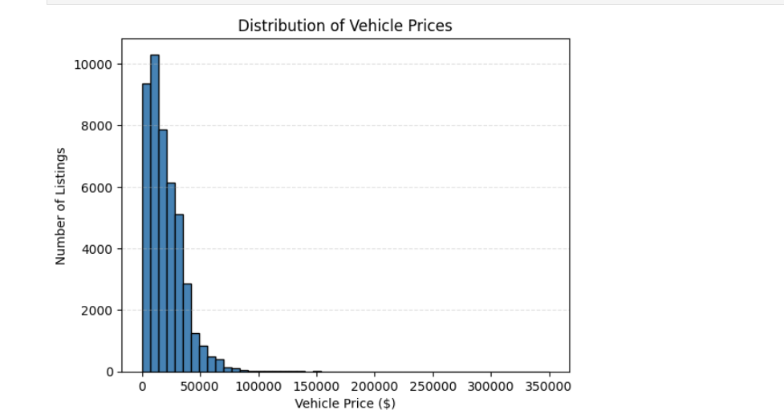

# 🚗 Vehicle Data Cleaning & Exploratory Data Analysis

A Python data science project focused on cleaning, transforming, exploring, and visualizing used vehicle listings from Craigslist using Pandas, NumPy, and Matplotlib.

---

## 📌 Table of Contents

- [Project Overview](#-project-overview)
- [Objectives](#-project-objectives)
- [Technologies Used](#-technologies-used)
- [Dataset Description](#-dataset-description)
- [Project Structure](#-project-structure)
- [Data Cleaning and Preparation](#-data-cleaning-and-preparation)
- [Exploratory Data Analysis](#-exploratory-data-analysis)
- [Data Visualization](#-data-visualization)
- [Key Findings](#-key-findings)
- [How to Run the Project](#️-how-to-run-the-project)
- [Future Improvements](#-future-improvements)
- [Author](#-author)

---

## 📌 Project Overview

Real-world datasets often contain missing values, inconsistent information, unusual observations, and data that requires transformation before analysis.

This project explores a dataset of used vehicle listings from Craigslist. It follows a practical data analysis workflow, beginning with raw data inspection and cleaning, followed by feature engineering, exploratory data analysis (EDA), statistical analysis, and visualization.

The main goal is to understand the characteristics of the listings and investigate how vehicle prices relate to factors such as manufacturer, model year, vehicle age, and odometer reading.

The project also provides a foundation for future machine learning work, such as predicting used vehicle prices.

## 🎯 Project Objectives

- Inspect and understand a real-world vehicle dataset.
- Identify missing values and potential data quality issues.
- Prepare a cleaned dataset for analysis.
- Create additional features to support analysis.
- Investigate price distributions and extreme values.
- Analyze manufacturer listing counts and average prices.
- Explore vehicle mileage and age distributions.
- Investigate relationships between numerical variables.
- Create clear, informative visualizations using Matplotlib.
- Communicate findings through statistical summaries and charts.

## 🛠️ Technologies Used

| Technology | Purpose |
|---|---|
| Python | Main programming language |
| Pandas | Data loading, cleaning, transformation, grouping, and analysis |
| NumPy | Numerical calculations and data operations |
| Matplotlib | Statistical and exploratory visualizations |
| Jupyter Notebook | Interactive data analysis |
| Git | Version control |
| GitHub | Project hosting and portfolio presentation |

## 📂 Dataset Description

**Dataset:** Craigslist Cars and Trucks Data

**Source:** [Kaggle — Craigslist Cars and Trucks Data](https://www.kaggle.com/datasets/austinreese/craigslist-carstrucks-data)

The dataset contains used vehicle advertisements with information about vehicles and their listings. Depending on the available records, attributes include:

- Price
- Model year
- Manufacturer
- Odometer reading
- Vehicle condition and characteristics
- Listing descriptions
- Other advertisement details

### Dataset size

The project initially selected the first 50,000 rows from the raw dataset.

After cleaning, the resulting dataset contains:

| Property | Value |
|---|---:|
| Initial rows selected | 50,000 |
| Rows after cleaning | 45,094 |
| Columns in cleaned dataset | 29 |

These figures refer to the subset analyzed in this project, not the entire Kaggle dataset.

## 📁 Project Structure

```text
Vehicle-Data-Cleaning/
│
├── data/
│   ├── vehicles.csv
│   └── vehicles_cleaned.csv
│
├── images/
│   ├── price_distribution.png
│   ├── price_boxplot.png
│   ├── top_manufacturers.png
│   ├── mileage_distribution.png
│   ├── price_vs_odometer.png
│   └── correlation_heatmap.png
│
├── notebooks/
│   ├── matplotlib1.ipynb
│   ├── vehicle_data_cleaning.ipynb
│   ├── vehicle_eda.ipynb
│   └── vizualization.ipynb
│
├── .gitignore
└── README.md
```

The `data/` directory contains the raw subset and cleaned dataset. The `notebooks/` directory contains the code for cleaning, analysis, and visualization. The `images/` directory stores the chart images displayed in this README.

## 🧹 Data Cleaning and Preparation

Data cleaning is an important stage because errors, missing information, and inconsistent values can affect statistical summaries and visualizations.

The cleaning notebook prepares the vehicle dataset for further analysis.

### 1. Loading the dataset

The raw CSV file is loaded into a Pandas DataFrame.

The initial inspection helps determine the dataset's dimensions, column names, data types, and general structure.

Typical inspection operations include:

```python
df.head()
df.shape
df.info()
df.describe()
```

These operations help identify the types of information available and areas that may require further investigation.

### 2. Inspecting missing values

Missing values are identified using Pandas.

```python
df.isnull().sum()
```

This helps determine which columns contain incomplete information and how many records are affected.

In the cleaned dataset, the previously observed missing values included:

| Column | Missing values |
|---|---:|
| `vin` | 17,312 |
| `odometer` | 45 |
| `mileage_category` | 45 |
| `vehicle_age` | 2 |
| `description` | 1 |

Missing values do not always mean that a record is invalid. For example, a vehicle listing can still be useful for price analysis even when its VIN is unavailable.

The treatment of missing values should therefore depend on the purpose of the analysis and the operations implemented in the cleaning notebook.

### 3. Investigating unusual prices

Vehicle prices are inspected using descriptive statistics and visualizations.

The analysis identified listings with very low prices, including 123 listings priced at $1.

Such values may represent placeholders, incomplete advertisements, or genuine unusual listings. They should be investigated before being removed or modified.

Extreme prices are also examined using the interquartile range (IQR) method.

The IQR is calculated as:

`IQR = Q3 - Q1`

The upper outlier boundary is:

`Upper fence = Q3 + 1.5 × IQR`

For the analyzed subset:

| Statistic | Value |
|---|---:|
| First quartile (Q1) | $8,499 |
| Third quartile (Q3) | $28,590 |
| Interquartile range | $20,091 |
| Upper outlier fence | $58,726.50 |
| Listings above upper fence | 1,214 |

These are statistical outliers, not automatically confirmed errors. Expensive or rare vehicles can legitimately have high prices.

### 4. Inspecting odometer readings

Odometer readings are examined to understand vehicle usage and identify unusually high mileage values.

The IQR analysis produced the following results:

| Statistic | Value |
|---|---:|
| First quartile (Q1) | 35,036 miles |
| Third quartile (Q3) | 127,036 miles |
| Interquartile range | 92,000 miles |
| Upper outlier fence | 265,036 miles |
| Listings above upper fence | 586 |

These observations require investigation because very high mileage can be valid for older vehicles or vehicles used extensively.

### 5. Creating additional features

Additional columns allow the data to be analyzed from different perspectives.

**Vehicle age**

Vehicle age is derived from the model year and a reference year. The reference year must be defined consistently so that the feature can be reproduced.

**Mileage category**

Odometer readings can be grouped into categories such as:

- Very Low
- Low
- Medium
- High
- Very High

The category boundaries should be documented in the cleaning notebook. These categories simplify the analysis of mileage patterns.

### 6. Saving the cleaned dataset

The prepared data is saved separately from the original dataset:

```text
data/
├── vehicles.csv
└── vehicles_cleaned.csv
```

Keeping the original file preserves the raw data and makes it possible to compare the cleaning results with the source subset.

---

## 🔎 Exploratory Data Analysis (EDA)

Exploratory Data Analysis is used to understand the dataset, discover patterns, investigate unusual observations, and examine relationships between variables.

The EDA notebook combines descriptive statistics, grouping operations, correlation analysis, and visualizations.

### 1. Vehicle price analysis

The analysis examines the distribution of listing prices using the mean, median, quartiles, and range.

| Metric | Result |
|---|---:|
| Mean price | $20,162.06 |
| Median price | $16,590 |
| Minimum price | $1 |
| Maximum price | $349,999 |

The mean is higher than the median, suggesting that high-priced listings influence the overall average.

The price distribution is therefore likely to be right-skewed, with most listings at lower prices and a smaller number at much higher prices.

### 2. Price category analysis

Vehicle prices are grouped into four categories.

| Price category | Listings | Percentage |
|---|---:|---:|
| Budget | 14,525 | 32.21% |
| Mid-Range | 16,618 | 36.85% |
| Expensive | 11,982 | 26.57% |
| Luxury | 1,969 | 4.37% |

Budget and Mid-Range listings account for approximately 69.06% of the analyzed subset.

This suggests that most listings in this sample fall into the two lower price categories. The category boundaries are specific to this project and should be documented in the notebook.

### 3. Manufacturer analysis

Manufacturer counts are examined to identify the most frequently advertised brands.

The most common manufacturers in the analyzed subset include:

| Manufacturer | Listings |
|---|---:|
| Ford | 7,020 |
| Chevrolet | 5,800 |
| Toyota | 4,093 |
| Honda | 2,221 |
| Nissan | 2,194 |

Ford and Chevrolet have the highest listing counts in this sample.

Manufacturer listing counts describe the composition of the dataset. They should not be interpreted as direct measurements of overall vehicle sales or market share.

### 4. Average price by manufacturer

The mean price is calculated for each manufacturer to compare average advertised prices.

Some of the highest average prices were observed for Ferrari, Aston Martin, and Porsche.

However, average prices for manufacturers with very few listings can be strongly influenced by individual vehicles. A fair comparison should consider manufacturer sample sizes and ideally apply a minimum listing-count threshold.

### 5. Mileage analysis

Odometer readings are explored using descriptive statistics and a histogram.

Mileage categories are also compared to understand how listings are distributed across different usage levels.

The analysis investigates whether vehicles with higher odometer readings tend to have lower advertised prices.

### 6. Vehicle age analysis

Vehicle age is examined alongside odometer readings and listing prices.

Older vehicles may have accumulated more mileage, but mileage also depends on usage patterns, maintenance, and how frequently a vehicle is driven.

Vehicle age is derived from model year, so the relationship between these two variables is mathematically linked rather than an independent discovery.

### 7. Correlation analysis

Correlation coefficients are calculated to measure the strength and direction of linear relationships between selected numerical variables.

| Variable pair | Correlation | Interpretation |
|---|---:|---|
| Price and odometer | -0.403 | Moderate negative relationship |
| Price and vehicle age | -0.284 | Weak negative relationship |
| Price and model year | +0.284 | Weak positive relationship |
| Vehicle age and odometer | +0.300 | Weak positive relationship |
| Model year and odometer | -0.300 | Weak negative relationship |
| Model year and vehicle age | -1.000 | Perfect inverse relationship due to the derived age feature |

Correlation does not establish causation. A relationship between price and mileage does not mean that mileage alone determines a vehicle's price.

---

## 📊 Data Visualization

The following six visualizations summarize important findings from the EDA. Save the chart images in the `images/` directory using the filenames shown below.

### 1. Vehicle Price Distribution

This histogram illustrates the distribution of advertised vehicle prices and helps reveal skewness and the presence of high-priced listings.



### 2. Vehicle Price Outliers

This box plot summarizes the distribution of vehicle prices using the median, quartiles, and potential outliers.


### 3. Top 10 Manufacturers by Number of Listings

This bar chart compares listing counts across the most frequently represented manufacturers in the analyzed subset.


### 4. Vehicle Mileage Distribution

This histogram illustrates the distribution of odometer readings and helps identify common mileage ranges and unusually high values.


### 5. Vehicle Price vs. Odometer Reading

This scatter plot investigates the relationship between odometer readings and advertised prices. The analyzed subset has a correlation coefficient of approximately -0.403.


### 6. Correlation Heatmap

The heatmap visualizes the correlations among price, model year, odometer reading, and vehicle age.

It highlights the negative relationship between price and odometer reading, as well as the mathematically linked relationship between model year and vehicle age.


---

## 💡 Key Findings

- The cleaned subset contains 45,094 listings and 29 columns.
- The mean listing price is approximately $20,162, while the median is $16,590.
- Budget and Mid-Range listings account for approximately 69.06% of the subset.
- Ford and Chevrolet are the most frequently listed manufacturers in the analyzed data.
- Price and odometer reading have a moderate negative correlation of approximately -0.403.
- Vehicle age and odometer reading have a weak positive correlation of approximately +0.300.
- Statistical outliers require investigation rather than automatic removal.
- Manufacturer comparisons should account for differences in sample sizes.

These results describe the analyzed subset of listings and may not generalize to all vehicles or markets.

## ⚙️ How to Run the Project

### Prerequisites

Install Python and Git. You can run the notebooks in VS Code or Jupyter Notebook.

### 1. Clone the repository

```bash
git clone https://github.com/YOUR_USERNAME/vehicle-data-cleaning-eda.git
```

Replace `YOUR_USERNAME` with your GitHub username.

### 2. Enter the project directory

```bash
cd vehicle-data-cleaning-eda
```

### 3. Install dependencies

```bash
pip install pandas numpy matplotlib jupyter
```

### 4. Start Jupyter Notebook

```bash
jupyter notebook
```

### 5. Run the notebooks

Open the notebooks in the `notebooks/` directory.

Run the data cleaning notebook first if you need to regenerate `vehicles_cleaned.csv`. Then open the EDA notebook to explore the statistical analysis and visualizations.

Ensure the CSV files are present in the `data/` directory before running the notebooks.

## 🚀 Future Improvements

- Document all cleaning rules and feature-engineering decisions.
- Investigate unusual values using vehicle characteristics and domain context.
- Compare manufacturer prices using minimum sample-size thresholds.
- Add more visualizations to explore vehicle condition, fuel type, transmission, and other attributes.
- Create an interactive dashboard.
- Develop a supervised machine learning model to predict vehicle prices.
- Evaluate regression models using MAE, RMSE, and R².
- Compare model performance using appropriate validation techniques.

## 👨‍💻 Author

This project was developed as a practical learning exercise in Python programming, data cleaning, exploratory data analysis, and data visualization.

---

**If you find this project useful, explore the notebooks to see the complete analysis workflow.**
